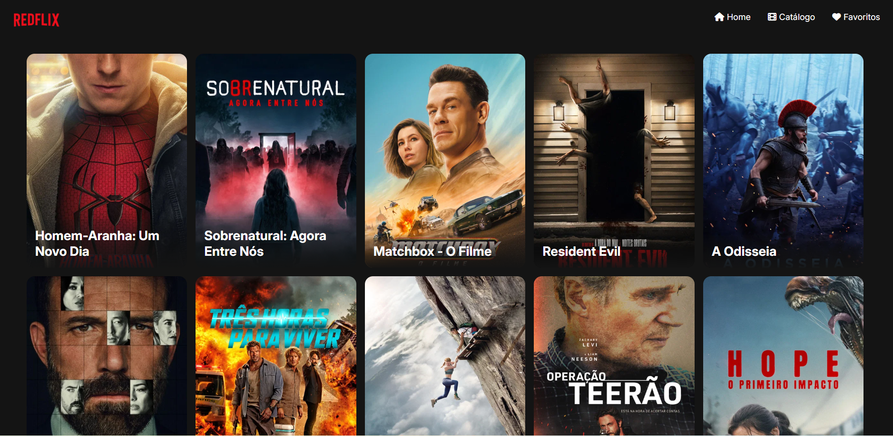

# REDFLIX

## Componetização

Foram criados componentes reutilizáveis para organizar a estrutura do site, facilitar a manutenção do código e evitar duplicações.

### FilmeCard

- O filmeCard é responsável pela exibição dos filmes nas páginas catálogos e favoritos. Cada filme da lista é representado por um filmeCard, as informações são recebidas por meio de Props. Permitindo reutilizar o mesmo componene em diversas partes da aplicação

### Hero

- O componente Hero é responsável pela renderização dos filmes na página home. Cada filme em destaque é representado por um Hero, os filmes são buscados através de um useEffect e renderizados através de um map em cima de uma lista de filmes.

* Além desses componentes foram criados também os componentes header e footer que são utilizados durante toda a aplicação.
